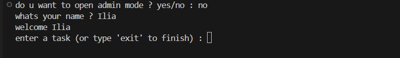
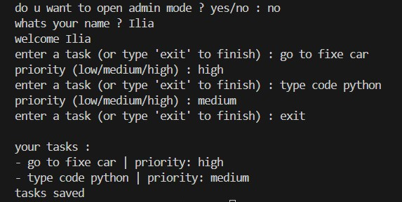

# Personal Task Manager


A simple command-line task manager built with Python.

## Description

Personal Task Manager is a Python CLI application that helps you manage your personal tasks. You can enter your name, add tasks, view them, mark them as done, and delete them. Tasks are saved in a file, so they are not lost when you close the program. The app also has a simple Admin Mode protected by a password stored in a `.env` file.

This project was built step by step as a practical exercise for learning the Git & GitHub workflow: commits, branches, `.gitignore`, and environment variables.

## Table of Contents

- [Personal Task Manager](#personal-task-manager)
- [Table of contents](#table-of-contents)
- [Features](#features)
- [Project Structure](#project-structure)
- [File Description](#file-description)
- [Requirements](#requirements)
- [Installation](#installation)
- [Environment Setup](#environment-setup)
- [Usage](#usage)
- [Example Output](#example-output)
- [Screenshot](#screenshot)
- [Demo](#demo)
- [Roadmap](#roadmap)
- [Contributing](#contributing)
- [License](#license)
- [Author](#author)

## Features

- Ask for the user's name and show a welcome message
- Add new tasks (one or many)
- View all tasks
- Each task has a title and a status: `pending` or `done`
- Mark a task as done
- Delete a task
- Tasks are saved in a text file and loaded again on the next run
- Simple Admin Mode protected by a password
- Admin password is stored in `.env`, not in the Python code

## Project Structure

```
personal_task_manager/
├── pictures/
│   ├── 1.png
│   ├── 2.png
│   └── 3.png
├── gifs/
│   └── demo.gif
├── main.py
├── tasks.py
├── requirements.txt
├── .env.example
├── .gitignore
└── README.md
```

> Files such as `.env` and `tasks.txt` are created locally and are ignored by Git, so they are not part of the repository.

## File Description

| File | Description |
|---|---|
| `main.py` | Entry point of the program. Handles user input, the main loop, and Admin Mode. |
| `tasks.py` | Contains the task logic: adding, showing, saving, and loading tasks. |
| `requirements.txt` | List of Python packages needed to run the project. |
| `.env.example` | Example of the environment file. Contains no real password. |
| `.gitignore` | Tells Git which files to ignore (such as `.env` and `tasks.txt`). |
| `pictures/` | Screenshots used in this README. |
| `gifs/` | Demo GIF used in this README. |
| `README.md` | Project documentation. |

## Requirements

- Python 3.10 or higher
- `python-dotenv` package
- Git (to clone the repository)

## Installation

1. Clone the repository:

```bash
git clone https://github.com/Ilia-ID59/personal_task_manager.git
```

2. Go into the project folder:

```bash
cd personal_task_manager
```

3. Install the required packages:

```bash
pip install -r requirements.txt
```

## Environment Setup

1. Copy the example file and rename it to `.env`:

```bash
copy .env.example .env
```

(On Linux/macOS use `cp .env.example .env`.)

2. Open `.env` and set your own admin password:

```
TASK_MANAGER_ADMIN_PASSWORD=your_password_here
```

> Never commit your real `.env` file to GitHub.

## Usage

Run the program:

```bash
python main.py
```

Then:

1. Choose whether to open Admin Mode (and enter the password if you do)
2. Enter your name
3. Add tasks, view them, mark them as done, or delete them
4. Type `exit` to finish. Your tasks are saved automatically.

## Example Output

```
do u want to open admin mode ? yes/no : no
whats your name ? Ilia
welcome Ilia
enter a task (or type 'exit' to finish) : go to fixe car
enter a task (or type 'exit' to finish) : type code python
enter a task (or type 'exit' to finish) : exit

your tasks :
- go to fixe car
- type code python
tasks saved
```

> Update this section to match the real output of your final version.

## Screenshot






## Demo


## Roadmap

- [x] Ask for user name
- [x] Add multiple tasks
- [x] Save and load tasks from a file
- [x] Admin Mode with password from `.env`
- [ ] Mark tasks as done
- [ ] Delete tasks
- [ ] Add due dates to tasks
- [ ] Add task priorities

## Contributing


## License


## Author

- **Name:** ilia
- **GitHub:** [@Ilia-ID59](https://github.com/Ilia-ID59/personal_task_manager.git)
